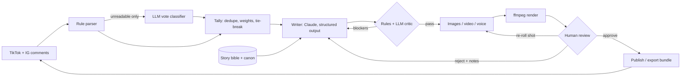

# tiktok-choices

A daily choose-your-own-adventure series for TikTok and Instagram Reels where AI writes, voices and renders every episode, and the audience steers the story by commenting **A** or **B**.

Every day the pipeline:

1. **reads yesterday's vote** from TikTok and Instagram comments ("A", "b po", "team bike", "anything but the mall", ...),
2. **writes the next episode** against a story bible and running canon, with a critic pass and an automatic revise loop,
3. **generates the media**: one still per shot (with locked character looks), optional image-to-video, and narration with word-level timing,
4. **renders a 9:16 video** with a hook overlay, word-by-word captions, an ambient bed and an A/B choice card,
5. **stops for a human** to approve, reject with notes, or re-roll a single shot,
6. **publishes** (or exports a ready-to-post bundle), then waits for the voting window to close.

The included series is **TULOG**, set in Metro Manila the morning after. The infected stand perfectly still until you make a sound. Swap `config/series.yaml` for any premise.



## Try it offline (no API keys)

Requires Python 3.11+ and `ffmpeg` on your PATH.

```bash
python -m venv .venv && source .venv/bin/activate
```

```bash
pip install -e ".[dev]"
```

```bash
choices --offline demo --days 3 --fast
```

This runs three full days with a simulated, messy comment section (Taglish, emoji, mind-changers, spam, a prompt-injection attempt, late comments). It writes everything to `runs/demo/tulog/`. Open `runs/demo/tulog/index.html` to browse the episodes, each with its video, review page and vote breakdown.

`--offline` swaps every paid provider for a local stand-in: a scripted writer, procedural key art labelled *OFFLINE PREVIEW FRAME*, and silent narration with realistic timing. Rendering, captions, voting, state and review pages all run for real. Drop `--fast` for full 1080×1920.

## Run it for real

1. Copy `.env.example` to `.env` and fill in what you have. Every integration is optional and replaceable:

   | Stage | Default provider | Env |
   |---|---|---|
   | Writer, critic, vote classifier | Claude (`claude-opus-5-5`) | `ANTHROPIC_API_KEY` |
   | Images (and optional image-to-video) | fal.ai (FLUX / Kling, configurable) | `FAL_KEY` |
   | Narration with word timestamps | ElevenLabs | `ELEVENLABS_API_KEY` |
   | TikTok comments (+ API publishing) | TikTok API for Business | `TIKTOK_BUSINESS_ID`, `TIKTOK_ACCESS_TOKEN` |
   | Instagram comments (+ Reels publishing) | Instagram Graph API | `IG_USER_ID`, `IG_ACCESS_TOKEN` |

2. Pick providers, models and voting rules in `config/pipeline.yaml`. Set `models.elevenlabs_voice_id` to a narrator voice.

3. Run the loop. It's idempotent, so cron it hourly:

   ```bash
   choices run
   ```

   ```cron
   0 * * * * cd /path/to/tiktok-choices && .venv/bin/choices run >> runs/cron.log 2>&1
   ```

### A day in the life

```bash
choices run                                   # writes + renders day N, stops at review
choices approve --day 4                       # or:
choices reject  --day 4 --note "Hook is weak; open on the sound, not the silence"
choices reroll  --day 4 --scene 3             # one bad frame? regenerate just that shot
choices link    --day 4 --tiktok 7301... --instagram 1789...   # after posting the export bundle
choices status
```

No API approval yet? Export comments any way you can (CSV or JSON with a `text` column) and either drop them in `runs/<series>/day-NNN/inbox/` or run `choices tally --day N --comments export.csv`.

## How a comment becomes a vote

The parser handles the easy majority with rules: explicit letters (`A`, `bbbb`, `option b po`, `#teamA`, `🅰️`, `2`), keywords the writer provided for each option (including Tagalog), the full option label, and yes/no/true/false for yes-no questions. It knows that `A zombie would hear you` is an article, not a vote.

Only genuinely ambiguous comments (negations like `wag mo buksan`, conflicts like `A or B? idk`, free text) go to the LLM classifier, in batches, with comment text fenced as untrusted data.

The tally then applies the voting policy:

- **One vote per person per platform.** A viewer who changes their mind keeps their latest vote (configurable to first).
- **Exclusions.** Your own account's comments, comments after the cutoff, and link spam don't count.
- **Weights.** Optional capped like-weighting and per-platform weights.
- **Ties and low turnout.** Decided by a seeded coin flip, which tomorrow's episode admits to on screen.
- **Audit trail.** Every comment's fate is written to `votes_audit.json`.

The most-liked substantive comments can be paraphrased in the next episode. Anything that looks like an instruction to a model is never quoted back into a prompt.

## Layout

```
config/series.yaml        story bible (creative brief; creators own this)
config/pipeline.yaml      providers, models, voting rules (engineers own this)
src/choices/
  pipeline.py             resumable daily state machine
  story/                  prompts, writer, critic + revise loop, canon, offline writer
  votes/                  rule parser, LLM classifier, tally
  media/                  prompt compiler (locked looks), fal.ai, ElevenLabs, offline stand-ins
  render/                 ffmpeg composer, ASS karaoke captions, choice card + cover
  social/                 TikTok Business API, Instagram Graph API, file import, export bundle
  review.py               per-episode review page + series index
tests/                    parser, tally, critic loop, adapters (mocked HTTP), full pipeline
docs/DESIGN.md            the judgment calls and why
```

## Status and caveats

- The offline path is exercised end to end by the tests and the demo.
- The TikTok, Instagram, fal.ai and ElevenLabs adapters are written against their documented APIs and tested against mocked HTTP responses. They have **not yet been run against live accounts** from this repo, so expect to adjust field names on first contact. Image and video model IDs in particular change often, so pin the ones you've tested.
- Platform publishing APIs need app review. Unaudited TikTok apps can only post privately. That's why `publish.mode: export` (post by hand, then `choices link`) is the default.
- Neither platform exposes native poll-sticker results through its API, so the series votes in comments. Comments are also the stronger engagement signal.
- Keep the platforms' AI-generated content labels on. The caption template adds a disclosure line by default.

## Development

```bash
pytest
```

```bash
ruff check src tests
```
