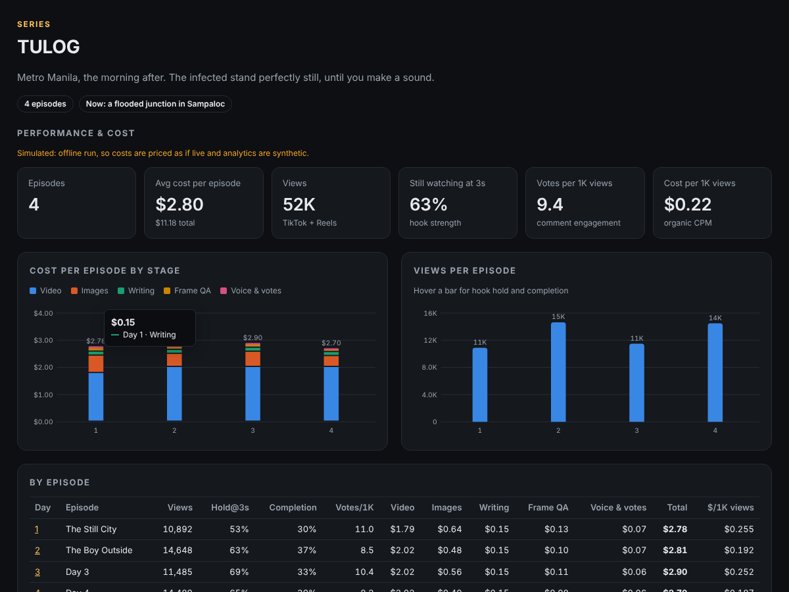
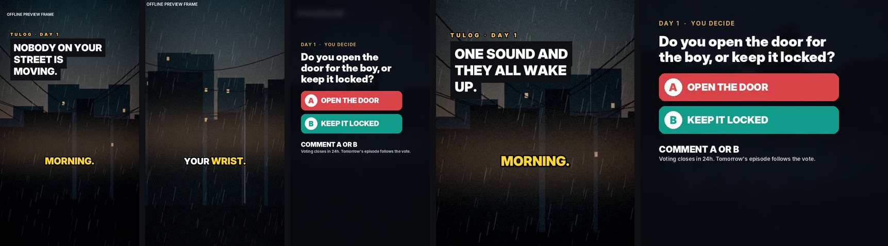
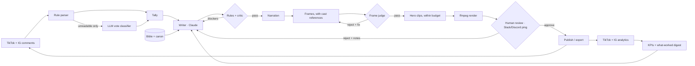

# tiktok-choices

A daily choose-your-own-adventure series for TikTok and Instagram Reels where AI writes, illustrates, animates and voices every episode, the audience steers the story by commenting **A** or **B**, and analytics tell the writer what's working.



## At a glance

| | |
|---|---|
| **Automation** | One idempotent `choices run` (or `choices loop` in Docker) advances the series: read yesterday's votes, write, generate, QA, render, ping a human for review, publish, pull analytics. It resumes from the failed step after a crash. |
| **Cost control** | An itemised ledger on every episode, a per-episode budget that degrades gracefully, and image-to-video only on the 1-2 "hero" shots with native audio off. Projected **$3.19 per episode vs $9.35** with every shot animated (`choices estimate`). |
| **Quality gates** | Rule checks, an LLM critic with a revise loop, a **vision judge on every frame** that re-rolls bad ones before they become paid clips, and a human approve/reject/re-roll step. |
| **Impact** | TikTok retention and Reels skip-rate analytics feed KPIs (3s hold, completion, votes per 1K views, cost per 1K views) back into the writer prompt. One command turns an episode into hooks × 9:16/4:5/1:1 **ad variants at $0 extra media cost**. |
| **Current models** (Nov 2026) | Claude Opus 5.5 (structured outputs, adaptive thinking, per-route effort, caching, refusal fallback) · Nano Banana 2 with up to 14 reference images for character consistency · Kling v3 Pro · ElevenLabs with word timestamps. Rationale and alternatives: [docs/MODELS.md](docs/MODELS.md). |
| **Model testing** | `choices bakeoff` runs our own shots through candidate image models and ranks them by **$ per usable frame** (cost × QA pass rate). |



The included series is **TULOG**, set in Metro Manila the morning after an outbreak. The infected stand perfectly still until you make a sound. Swap `config/series.yaml` for any premise.

## How a day works



## Try it offline (no API keys)

Requires Python 3.11+ and `ffmpeg`.

```bash
python -m venv .venv && source .venv/bin/activate
```

```bash
pip install -e ".[dev]"
```

```bash
choices --offline demo --days 3 --fast --variants
```

This runs three full days with a simulated, messy comment section (Taglish, emoji, mind-changers, spam, a prompt-injection attempt) plus simulated analytics. It also cuts nine ad variants of day 1. Open `runs/demo/tulog/index.html` to see the dashboard, each episode's review page, its itemised cost and its vote breakdown.

`--offline` swaps every paid provider for a local stand-in: a scripted writer, procedural key art labelled *OFFLINE PREVIEW FRAME*, silent narration with realistic timing, and a judge that rejects about one in four first attempts. It still **prices those calls as if they were the configured real models**, so budgets, the dashboard and the re-roll logic behave like production. Everything simulated is labelled as such.

## Run it for real

1. Copy `.env.example` to `.env`. Every integration is optional and swappable:

   | Stage | Default | Env |
   |---|---|---|
   | Writer, critic, frame judge, vote classifier, hook writer | Claude Opus 5.5 | `ANTHROPIC_API_KEY` |
   | Images, with reference sheets | fal.ai Nano Banana 2 (+ `/edit`) | `FAL_KEY` |
   | Hero-shot image-to-video | fal.ai Kling v3 Pro | `FAL_KEY` |
   | Narration with word timestamps | ElevenLabs | `ELEVENLABS_API_KEY` |
   | TikTok comments, analytics, publishing | TikTok API for Business | `TIKTOK_BUSINESS_ID`, `TIKTOK_ACCESS_TOKEN` |
   | Instagram comments, insights, Reels publishing | Instagram Graph API | `IG_USER_ID`, `IG_ACCESS_TOKEN` |
   | Review pings | Slack or Discord webhook | `REVIEW_WEBHOOK_URL` |

2. Set `models.elevenlabs_voice_id` in `config/pipeline.yaml` and check the `pricing:` table.

3. Check the projected spend, then generate the cast reference sheets once:

   ```bash
   choices estimate
   ```

   ```bash
   choices cast
   ```

4. Run it. Locally, cron `choices run` hourly; on a server or VM:

   ```bash
   docker compose up -d
   ```

### Commands

```bash
choices run                                   # advance one step (idempotent; cron it)
choices approve --day 4                       # publish a reviewed episode
choices reject  --day 4 --note "Hook is weak; open on the sound"
choices reroll  --day 4 --scene 3             # regenerate one shot (re-judged, re-animated if hero)
choices link    --day 4 --tiktok 7301... --instagram 1789...
choices tally   --day 4 --comments export.csv # votes from any comment export
choices metrics                               # pull analytics now
choices variants --day 4 --hooks 3 --formats 9:16,4:5,1:1
choices bakeoff --day 4 --models fal-ai/nano-banana-2/edit,fal-ai/nano-banana-pro/edit
choices estimate                              # projected $/episode for each setting
choices status
```

## How a comment becomes a vote

The parser handles the easy majority with rules: explicit letters (`A`, `bbbb`, `option b po`, `#teamA`, `🅰️`, `2`), the writer's keywords for each option (including Tagalog), the full option label, and yes/no/true/false for yes-no questions. It knows that `A zombie would hear you` is an article, not a vote.

Only genuinely ambiguous comments (negations like `wag mo buksan`, conflicts like `A or B? idk`, free text) go to the LLM, in batches, with comment text fenced as untrusted data. The tally gives one vote per person per platform (latest wins), excludes your own account, late comments and link spam, and settles ties with a seeded coin flip that the next episode admits to. Every comment's fate is written to `votes_audit.json`. Top comments can be paraphrased in the next episode, but anything that reads like an instruction to a model is never quoted back into a prompt.

## Layout

```
config/series.yaml        story bible (creators own this)
config/pipeline.yaml      providers, models, prices, budget, voting rules (engineers own this)
src/choices/
  pipeline.py             resumable daily state machine
  costs.py                pricing, ledger + budget guard, estimates
  analytics.py            KPIs, the writer's performance digest, simulated insights
  bakeoff.py              image-model comparison harness
  dashboard.py, review.py series dashboard and per-episode review pages
  notify.py               Slack/Discord pings
  story/                  prompts, writer, critic + revise loop, hooks, canon, offline writer
  votes/                  rule parser, LLM classifier, tally
  media/                  fal.ai, ElevenLabs, frame judge, prompt compiler, offline stand-ins
  render/                 ffmpeg composer, karaoke captions, choice card, cover
  social/                 TikTok Business API, Instagram Graph API, file import, export bundle
tests/                    92 tests: parser, tally, critic loop, budget, QA re-rolls, adapters (mocked HTTP), full pipeline
docs/DESIGN.md            the judgment calls and why
docs/MODELS.md            which model does which job, alternatives, prices, sources
```

## Status and caveats

- The offline path is exercised end to end by the tests and the demo.
- The fal.ai, ElevenLabs, TikTok and Instagram adapters follow the providers' current documented schemas (for example Kling v3's `start_image_url` and `generate_audio`, and Nano Banana 2's `image_urls`) and are tested against mocked HTTP. They **have not yet been run against live accounts** from this repo.
- Prices in `config/pipeline.yaml` were checked on 2026-11-04 from fal's pages and third-party trackers. Re-verify before budgeting, and update `pricing.checked`.
- Platform publishing APIs need app review; unaudited TikTok apps can only post privately. That's why `publish.mode: export` (post by hand, then `choices link`) is the default.
- Neither platform exposes poll-sticker results through its API, so the series votes in comments. Comments are also the stronger engagement signal.
- Keep the platforms' AI-generated content labels on. The caption template adds a disclosure line by default.

## Development

```bash
pytest
```

```bash
ruff check src tests
```
